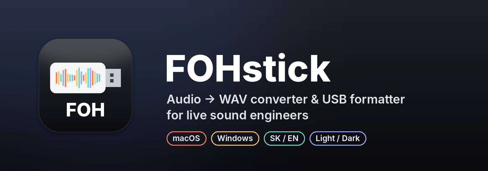

<p align="center">
  
</p>

<p align="center">
  <a href="https://github.com/fristik-eu/fohstick/releases/latest"></a>
  <a href="https://github.com/fristik-eu/fohstick/releases/latest"></a>
  
</p>

<p align="center"><b>English</b> · <a href="README.sk.md">Slovensky</a></p>

---

## The two jobs you do before every show – in one app

Someone hands you an MP3 for the walk-in music. The desk wants **WAV at 48 kHz**. Your USB stick is exFAT, 64 GB, and the console refuses to see it.

**FOHstick** fixes both in under a minute:

- **Convert** – drop in MP3, FLAC, AIFF, AAC/M4A or WAV and get clean **WAV at 44.1, 48 or 96 kHz**, 16 or 24 bit, mono or stereo.
- **Format** – pick your console from the list and FOHstick formats the USB drive **exactly the way that console expects**: file system, partition scheme, cluster size, partition size and drive name.

No command line. No hunting through PDF manuals. No third-party codecs.

---

## Features

### 🎵 Convert
- Input: **MP3, WAV, FLAC, AIFF, AAC / M4A** (any bitrate, any sample rate)
- Output: **WAV 44.1 / 48 / 96 kHz**, **16 / 24 bit**, **mono / stereo** (proper stereo → mono downmix)
- Batch conversion – add as many files as you like, drag & drop supported
- Originals stay untouched – the new file is saved next to it (`song_48k.wav`, `song_96k.wav`, …)
- Uses the audio engine built into the operating system – nothing to install

### 💾 Format USB for your console
- **13 console families** with ready-made presets (see below)
- **Custom mode** – FAT32 / exFAT / FAT16, default or 32 KB cluster, whole disk or 32 / 16 / 2 GB partition
- Automatically names the drive after the console (`SQ`, `DM`, `WING`, …)
- Formats **FAT32 on drives larger than 32 GB** – also on Windows, where the system tool can't
- Shows the current name of every connected USB drive, refreshes automatically when you plug one in
- **Safety first** – only external drives are listed, the system disk is refused, every format needs confirmation
- Step-by-step progress bar

### ✨ Comfort
- **Light / Dark / Auto** theme – follows the system or your choice
- **Slovak and English** – switch live, without restarting
- **Always up to date** – the console list is loaded from this repository, so new consoles arrive without reinstalling; the app tells you when a new version is out
- Native look on macOS and Windows

---

## Supported consoles

| Console | Preset | Drive name |
|---|---|---|
| Yamaha DM3 / DM5 / DM7 | FAT32 · MBR · whole disk (exFAT above 2 TB) | `DM` |
| Yamaha CL / QL | FAT32 · MBR · partition max. 32 GB (FAT16 up to 2 GB) | `CLQL` |
| Yamaha LS9 | FAT32 · MBR · partition max. 16 GB (FAT16 up to 2 GB) | `LS9` |
| Yamaha TF | FAT32 · MBR · whole disk, max. 2 TB | `TF` |
| Behringer X32 / Midas M32 | FAT32 · MBR · partition max. 32 GB | `X32` |
| Behringer X Air / Midas MR | FAT32 · MBR · partition max. 32 GB | `XAIR` |
| Behringer WING | FAT32 · MBR · partition max. 32 GB | `WING` |
| Allen & Heath SQ / SQ+ | FAT32 · MBR · 32 KB cluster · 2 GB – 2 TB | `SQ` |
| Allen & Heath Avantis | FAT32 · MBR · 32 KB cluster · 2 GB – 2 TB | `AVANTIS` |
| Allen & Heath dLive | FAT32 · MBR · 32 KB cluster · 2 GB – 2 TB | `DLIVE` |
| Allen & Heath Qu | FAT32 · MBR · 32 KB cluster · 2 GB – 2 TB | `QU` |
| Soundcraft Ui24R / Si | FAT32 · MBR · partition max. 32 GB | `SOUNDCRAFT` |
| DiGiCo SD / Quantum | FAT32 · MBR · whole disk, max. 2 TB | `DIGICO` |

Presets are based on the manufacturers' manuals and support articles. For Avantis, X32/M32, X Air and DiGiCo no official formatting spec was found – those presets use the safest known settings.

> **Missing your console?** Write to **apps@fristik.eu** – new presets go live for everyone without an app update.

---

## Download & install

Get the latest version from **[Releases](https://github.com/fristik-eu/fohstick/releases/latest)**.

### macOS (Apple Silicon & Intel, macOS 10.14+)
1. Download `FOHstick-x.y.z-mac.dmg` and open it.
2. Drag **FOHstick** into **Applications**.
3. First launch: macOS says the app can't be verified → open **System Settings → Privacy & Security** and click **Open Anyway**. Only needed once.
4. Formatting asks for your Mac password (required by macOS to erase disks).

### Windows 10 / 11
1. Download `FOHstick-x.y.z-windows.zip` and extract it (e.g. to `C:\FOHstick\`).
2. Run **FOHstick.exe**.
3. First launch: if SmartScreen appears, click **More info → Run anyway**. Only needed once.
4. A **FOHstick** shortcut is created on the desktop and in the Start menu.
5. Converting needs no special rights. Administrator approval (UAC) is requested **only when you format** a USB drive.

> `FOHstick (alternative).cmd` in the zip does the same as the .exe – use it if your antivirus blocks unknown .exe files.

---

## FAQ

**Is it really free?**
Yes. FOHstick is free for personal and commercial use – see [LICENSE](LICENSE).

**Why does macOS / Windows warn me on first launch?**
The app is not (yet) signed with a paid Apple / Microsoft developer certificate. The warning appears once; the full source is in this repository.

**Does it send any data?**
No. FOHstick only downloads two small public files from this repository – the console list and the latest version number. No analytics, no accounts, no tracking.

**Will it ever format my internal disk?**
No. Only external drives are listed, and the system disk is rejected even if requested directly.

**My USB stick is formatted but the console still won't record.**
Formatting is only half of it – the stick must also be fast enough. Use USB 3.0 sticks or SSDs from the manufacturer's tested list, and for Allen & Heath run *Format* once more on the console (it creates its folders).

---

## For developers

```
data/consoles.json     console presets (loaded by the app at runtime)
data/version.json      latest version (update check)
src/strings.tsv        all UI texts – Slovak & English
src/mac/               macOS app (AppleScriptObjC) + helper scripts
src/win/               Windows app (PowerShell / WinForms) + FAT32 formatter (C#)
build/                 build scripts (gen.py, build_mac.sh, build_win.ps1)
```

Pushing a tag `vX.Y.Z` builds the macOS `.dmg` and the Windows `.zip` with GitHub Actions and publishes them as a Release. To add a console, edit `data/consoles.json` – running apps pick it up on next launch.

---

<p align="center">
  <picture>
    <source media="(prefers-color-scheme: dark)" srcset="assets/fristik-logo-white.png">
    
  </picture><br>
  Made by <a href="https://fristik.eu">fristik.eu</a> · <a href="mailto:apps@fristik.eu">apps@fristik.eu</a><br>
  © 2026 fristik.eu
</p>
