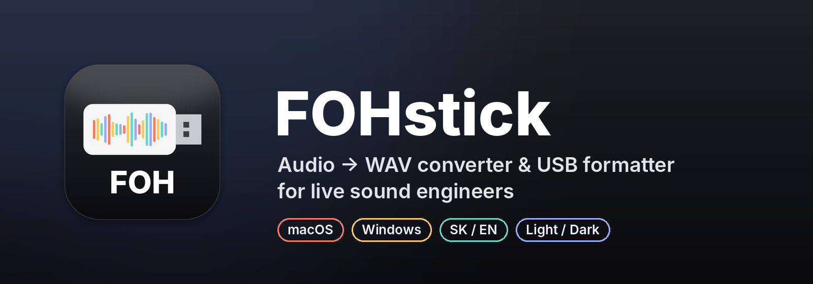

  

  
  
  

<a href="README.md">English</a> · <b>Slovensky</b>

---

## Dve veci, ktoré robíš pred každou akciou – v jednej apke

Niekto ti donesie MP3 na hudbu pred koncertom. Pult chce **WAV 48 kHz**. Tvoje USB má exFAT, 64 GB a pult ho nevidí.

**FOHstick** vyrieši oboje za menej ako minútu:

- **Convert** – vložíš MP3, FLAC, AIFF, AAC/M4A alebo WAV a dostaneš čistý **WAV 44,1, 48 alebo 96 kHz**, 16 alebo 24 bit, mono alebo stereo.
- **Format** – vyberieš pult zo zoznamu a FOHstick naformátuje USB **presne tak, ako to daný pult vyžaduje**: súborový systém, schému oddielov, veľkosť clustra, veľkosť oddielu aj názov disku.

Žiadny príkazový riadok. Žiadne hľadanie v PDF návodoch. Žiadne kodeky navyše.

---

## Funkcie

### 🎵 Convert
- Vstup: **MP3, WAV, FLAC, AIFF, AAC / M4A** (ľubovoľný bitrate a vzorkovanie)
- Výstup: **WAV 44,1 / 48 / 96 kHz**, **16 / 24 bit**, **mono / stereo** (poctivý zmix sterea do mona)
- Hromadný prevod – pridaj koľko súborov chceš, funguje aj pretiahnutie
- Originály ostanú nedotknuté – nový súbor sa uloží vedľa (`pesnicka_48k.wav`, `pesnicka_96k.wav`, …)
- Používa zvukový systém zabudovaný v operačnom systéme – nič sa neinštaluje

### 💾 Format USB pre tvoj pult
- **13 rodín pultov** s hotovým nastavením (pozri nižšie)
- **Vlastný formát** – FAT32 / exFAT / FAT16, predvolený alebo 32 KB cluster, celý disk alebo oddiel 32 / 16 / 2 GB
- Disk sa automaticky pomenuje podľa pultu (`SQ`, `DM`, `WING`, …)
- Naformátuje **FAT32 aj na disky väčšie ako 32 GB** – aj na Windowse, kde to systém nevie
- Ukazuje aktuálny názov každého pripojeného USB, zoznam sa obnoví sám po zasunutí
- **Bezpečnosť na prvom mieste** – zobrazujú sa iba externé disky, systémový disk apka odmietne, každé formátovanie treba potvrdiť
- Priebeh po krokoch

### ✨ Pohodlie
- Režim **Svetlý / Tmavý / Auto** – podľa systému alebo podľa teba
- **Slovenčina a angličtina** – prepneš za behu, bez reštartu
- **Vždy aktuálne** – zoznam pultov sa načítava z tohto repozitára, nové pulty pribudnú bez preinštalovania; apka ti dá vedieť o novej verzii
- Natívny vzhľad na macOS aj Windows

---

## Podporované pulty

| Pult | Nastavenie | Názov disku |
|---|---|---|
| Yamaha DM3 / DM5 / DM7 | FAT32 · MBR · celý disk (nad 2 TB exFAT) | `DM` |
| Yamaha CL / QL | FAT32 · MBR · oddiel max. 32 GB (do 2 GB FAT16) | `CLQL` |
| Yamaha LS9 | FAT32 · MBR · oddiel max. 16 GB (do 2 GB FAT16) | `LS9` |
| Yamaha TF | FAT32 · MBR · celý disk, max. 2 TB | `TF` |
| Behringer X32 / Midas M32 | FAT32 · MBR · oddiel max. 32 GB | `X32` |
| Behringer X Air / Midas MR | FAT32 · MBR · oddiel max. 32 GB | `XAIR` |
| Behringer WING | FAT32 · MBR · oddiel max. 32 GB | `WING` |
| Allen & Heath SQ / SQ+ | FAT32 · MBR · cluster 32 KB · 2 GB – 2 TB | `SQ` |
| Allen & Heath Avantis | FAT32 · MBR · cluster 32 KB · 2 GB – 2 TB | `AVANTIS` |
| Allen & Heath dLive | FAT32 · MBR · cluster 32 KB · 2 GB – 2 TB | `DLIVE` |
| Allen & Heath Qu | FAT32 · MBR · cluster 32 KB · 2 GB – 2 TB | `QU` |
| Soundcraft Ui24R / Si | FAT32 · MBR · oddiel max. 32 GB | `SOUNDCRAFT` |
| DiGiCo SD / Quantum | FAT32 · MBR · celý disk, max. 2 TB | `DIGICO` |

Nastavenia vychádzajú z návodov a článkov podpory výrobcov. Pre Avantis, X32/M32, X Air a DiGiCo sme oficiálnu požiadavku na formát nenašli – tam sa používa najbezpečnejšie známe nastavenie.

> **Chýba tvoj pult?** Napíš na **apps@fristik.eu** – nový pult sa objaví všetkým bez aktualizácie apky.

---

## Stiahnutie a inštalácia

Najnovšiu verziu nájdeš v **[Releases](https://github.com/fristik-eu/fohstick/releases/latest)**.

### macOS (Apple Silicon aj Intel, macOS 10.14+)
1. Stiahni `FOHstick-x.y.z-mac.dmg` a otvor ho.
2. Pretiahni **FOHstick** do **Aplikácií**.
3. Prvé spustenie: macOS ohlási, že apku nevie overiť → otvor **Nastavenia systému → Súkromie a bezpečnosť** a klikni **Aj tak otvoriť**. Stačí raz.
4. Pri formátovaní si apka pýta heslo Macu (macOS ho vyžaduje na mazanie diskov).

### Windows 10 / 11
1. Stiahni `FOHstick-x.y.z-windows.zip` a rozbaľ ho (napr. do `C:\FOHstick\`).
2. Spusti **FOHstick.exe**.
3. Prvé spustenie: ak sa objaví SmartScreen, klikni **Ďalšie informácie → Spustiť aj tak**. Stačí raz.
4. Na ploche a v ponuke Štart sa vytvorí zástupca **FOHstick**.
5. Na konvertovanie netreba žiadne práva. Potvrdenie správcu (UAC) si apka vypýta **až pri formátovaní** USB.

> `FOHstick (alternative).cmd` v zipe robí to isté ako .exe – použi ho, ak tvoj antivírus blokuje neznáme .exe súbory.

---

## Časté otázky

**Je to naozaj zadarmo?**
Áno. FOHstick je zadarmo na osobné aj komerčné použitie – pozri [LICENSE](LICENSE).

**Prečo ma macOS / Windows pri prvom spustení varuje?**
Apka zatiaľ nie je podpísaná plateným certifikátom Apple / Microsoft. Varovanie sa objaví len raz; celý zdrojový kód je v tomto repozitári.

**Posiela apka nejaké dáta?**
Nie. FOHstick len stiahne dva malé verejné súbory z tohto repozitára – zoznam pultov a číslo najnovšej verzie. Žiadna analytika, žiadne účty, žiadne sledovanie.

**Môže omylom naformátovať interný disk?**
Nie. Zobrazujú sa iba externé disky a systémový disk apka odmietne, aj keby o to niekto požiadal priamo.

**USB je naformátované, ale pult stále nenahráva.**
Formát je len polovica – USB musí byť aj dosť rýchle. Použi USB 3.0 kľúče alebo SSD zo zoznamu testovaných zariadení výrobcu a pri Allen & Heath daj ešte raz *Format* priamo na pulte (vytvorí si priečinky).

---

  <picture>
    <source media="(prefers-color-scheme: dark)" srcset="assets/fristik-logo-white.png">
    
  </picture> 
  Vyrobil <a href="https://fristik.eu">fristik.eu</a> · <a href="mailto:apps@fristik.eu">apps@fristik.eu</a> 
  © 2026 fristik.eu

